# Stock Screener 🇺🇸 🇨🇳 🇭🇰 🇯🇵 🇰🇷 🇹🇼 🇮🇳 🇩🇪 🇨🇦 🇸🇬 🇲🇾 🇦🇺

**Technical and fundamental scans, market breadth, group rankings, theme discovery and AI-assisted research**

Scan and track **US, Hong Kong, India, Japan, Korea, Taiwan, mainland China A-shares, Germany, Canada, Singapore, Malaysia, and Australia** markets. 

<p align="center">
  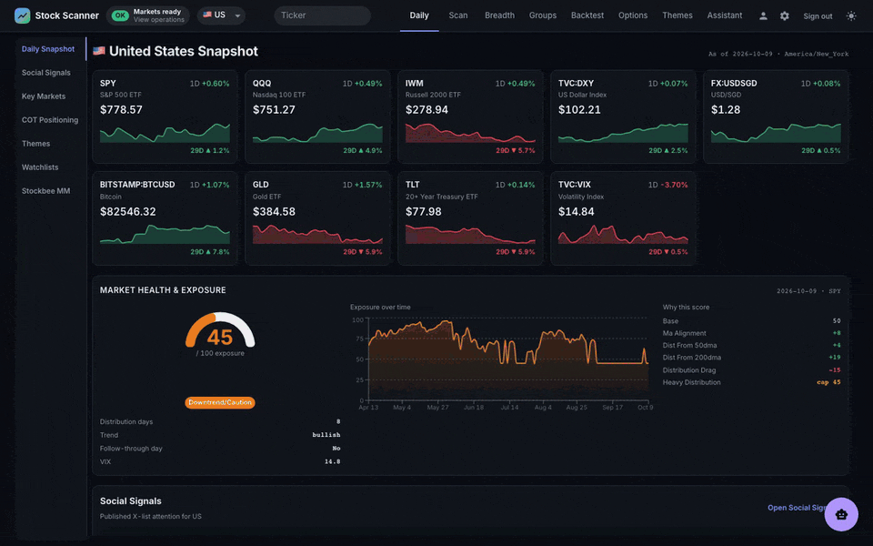
  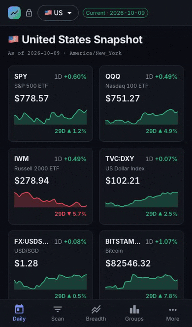
</p>

*Live app: Daily → Scan → stock detail → Groups → RRG → Stock Matrix · Static site on a phone: Daily → Scan cards → Breadth → RRG*

## Use it without installing

Read-only daily snapshot running on GitHub Pages:
**[xang1234.github.io/stock-screener](https://xang1234.github.io/stock-screener/)**

Updated daily after market close. 

Plain-HTML pages for every scannable stock, the main screens, group rankings and breadth, in all 12 markets: **[browse by market](https://xang1234.github.io/stock-screener/explore/)**.

See the **[Static Site Guide](docs/STATIC_SITE.md)** for exactly what works in static mode.

## Ask your AI assistant

The same daily data is available to Claude, Cursor, VS Code or any MCP client through **[stockscreen-mcp](stockscreen-mcp/)**. It needs no API keys and no server:

```bash
claude mcp add stockscreen -- uvx stockscreen-mcp
```

Then ask, for example: *"Which US stocks pass the Minervini trend template today, and which are in top-20 industry groups?"* It covers screens, RS ratings, market health and breadth, and group rankings for all 12 markets.

## Features

- **12-market coverage** -  exchange calendars, independent data and scans.
- **Multiple screening methodologies** - Minervini, CANSLIM, IPO, Volume Breakthrough, etc. with composite scoring.
- **Market Health and Exposure** - Market-regime overlay for position sizing and risk posture.
- **Market Breadth** - StockBee-style daily movers and trend windows, advance/decline and new-high/new-low health bars, T2108, a benchmark overlay, and a significance heatmap built from one shared calculation layer.
- **Industry groups with Relative Rotation Graph** - groups ranked by relative strength with movers (1W/1M/3M/6M) and constituent analysis, plus RRG charts plotting RS-Ratio vs RS-Momentum through (Leading → Weakening → Lagging → Improving). The Matrix tab adds Grid and Clusters layouts colored by 1-day, 1-week, 1-month change, or Stock RS.
- **Watchlists and Themes** - RS and price sparklines, multi-period change bars, drag-and-drop folders, and full-screen chart navigation.
- **Theme discovery** - AI theme identification from RSS, Twitter/X, and news feeds; tracks trending vs. emerging themes and alerts on momentum shifts.
- **AI research chatbot** - LLM powered chatbot with optional web search and persistent conversation history.
- **Operations** -  startup data bootstrap, runtime status, and Operations console for queues/jobs/telemetry.
- **Options Command Center** - opt-in US-only options context for the current top Candidates and Leaders, with focused gamma, volatility, skew, and activity views plus ticker history.
- **Backtest** -  Backtest page that validates published scan picks and theme alerts against price history.

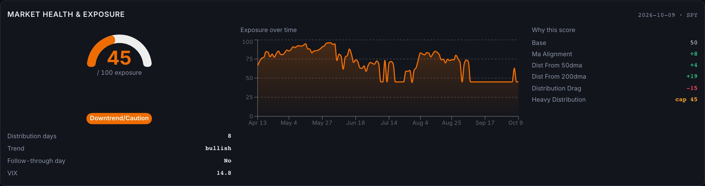
*Market Health and Exposure*

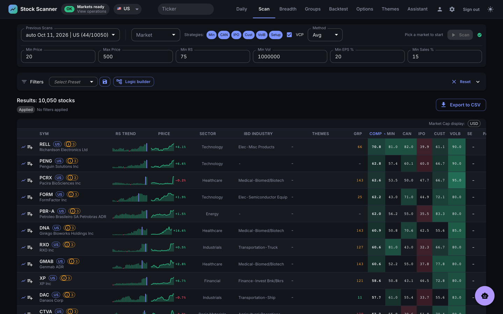
*Scan results table*

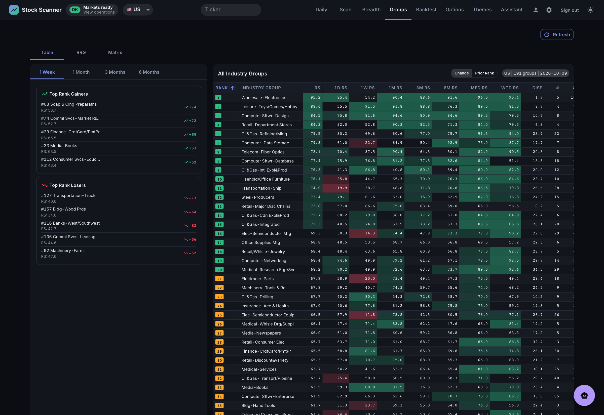
*Group RS: industry rankings, relative-strength statistics, and changes in group rank*

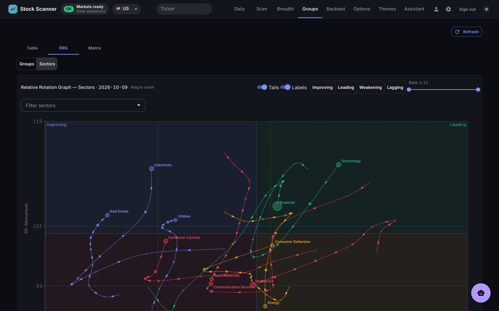
*RRG: sector rotation with direction-arrowed weekly tails; full 197-group scope available from the same view*

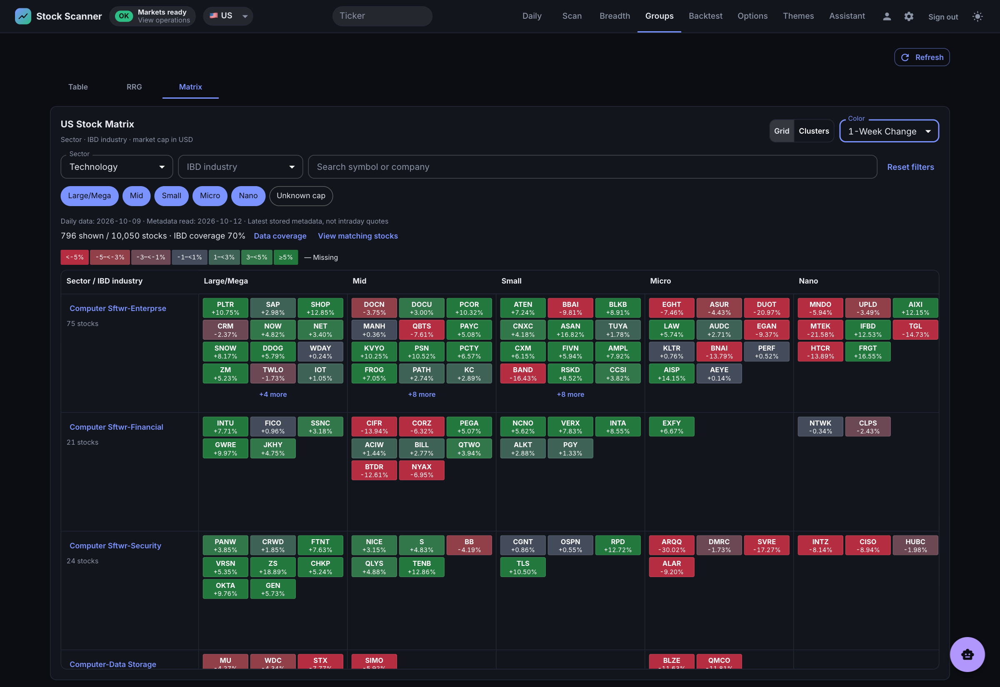
*Matrix Grid: sector and IBD industry rows, market-cap columns, and individual stock tiles*

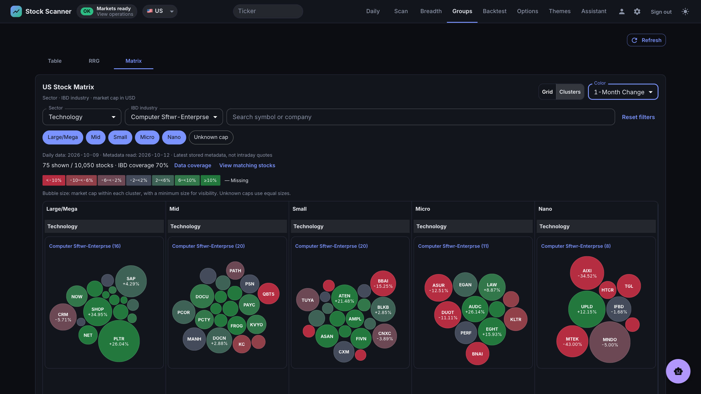
*Matrix Clusters: market-cap-sized bubbles with green centers and red perimeters. Both layouts support 1-day, 1-week, 1-month change, and Stock RS in the live app and static site. See the **[Group Matrix Guide](docs/GROUP_MATRIX_README.md)**.*

*Market Breadth combines advance/decline and new-high/new-low health bars with an SPY overlay and a color-coded history table for primary, secondary, and context indicators.*

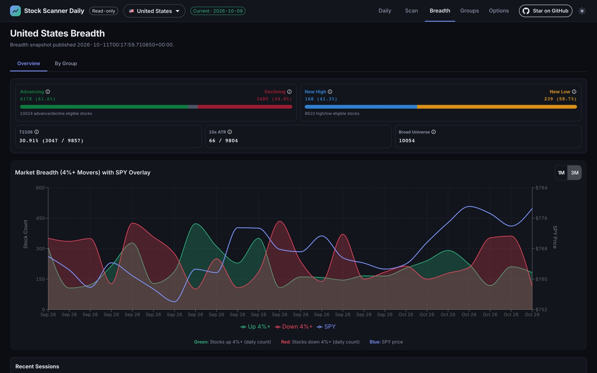

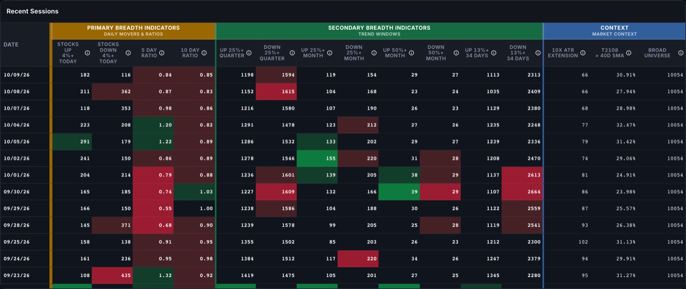

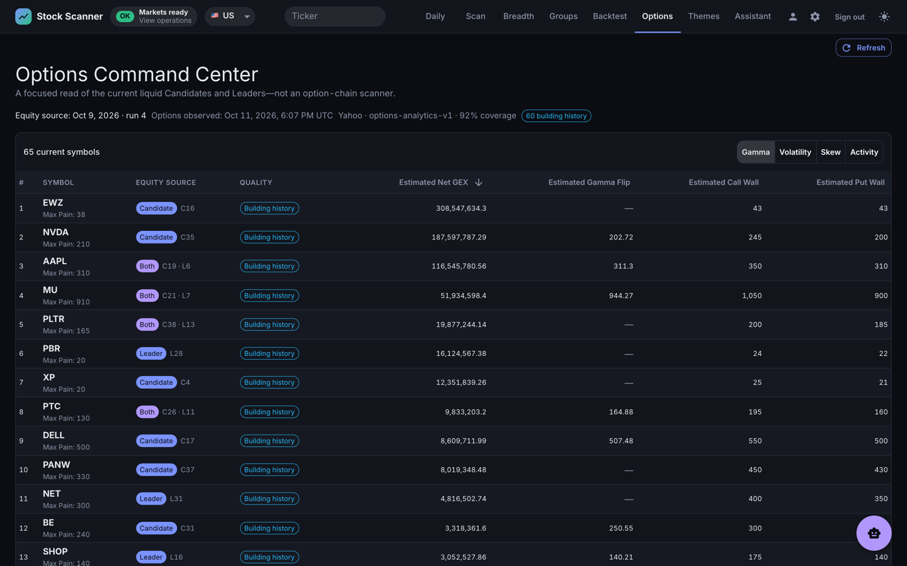
*Options Command Center: switch between Gamma, Volatility, Skew, and Activity views without scanning an entire option universe. See the **[Options Command Center Guide](docs/OPTIONS_COMMAND_CENTER.md)**.*

**Typical flow:** sign in → bootstrap markets → review the Daily dashboard → run a Scan → drill into a stock → monitor Operations → validate outcomes on Backtest. For the full page-by-page tour, see the **[Live App Guide](docs/LIVE_APP_GUIDE.md)**.

## Quickstart (Docker)

Needs Docker and Python 3.11+. One command pulls the published images that match your checkout, writes `.env.docker` with a generated login password, and waits until every service is healthy:

```bash
git clone https://github.com/xang1234/stock-screener.git
cd stock-screener
scripts/quickstart.sh
# Open the printed URL (http://localhost) and log in with the printed password
```

Add markets or change the port with `ENABLED_MARKETS=US,HK FRONTEND_PORT=8080 scripts/quickstart.sh`. Re-run it after `git pull` to upgrade. For the chatbot, add an LLM key such as `GROQ_API_KEY` to `.env.docker` and re-run. CI runs this same install against each published `main` build and release tag, and only creates a GitHub Release once it passes.

On first launch the app opens to a **first-run bootstrap** screen — no pre-seeded database needed. Pick one primary market for startup defaults and optionally enable more to hydrate in the background, then start. Enabling many markets at once noticeably slows the first run, so start with one and add the rest after the workspace is ready.

- **Homelab / VPS / local-dev compose / GHCR options:** [Docker Deployment](docs/INSTALL_DOCKER.md)
- **Building from source:** [Development Guide](docs/DEVELOPMENT.md)
- **Bootstrap stages, stale/failure handling, re-runs:** [Operations Guide](docs/OPERATIONS.md)

## Configuration

Scanning and all core features work with **no API keys**. The AI chatbot requires at least one LLM provider key.

| Provider | Env Var | Free Tier | Notes |
|----------|---------|-----------|-------|
| Groq | `GROQ_API_KEY` | Yes | Default for chatbot and research |
| Gemini | `GEMINI_API_KEY` | Yes | Extraction fallback |
| Minimax | `MINIMAX_API_KEY` | No | Primary theme-extraction provider |
| Z.AI | `ZAI_API_KEY` | No | Optional alternate provider |

Optional web-search keys (`TAVILY_API_KEY`, `SERPER_API_KEY`) are read by the Hermes assistant sidecar; the backend does not read them. Full reference: **[Environment Variables](docs/ENVIRONMENT.md)**.

## Application pages

| Route | Page | Description |
|-------|------|-------------|
| `/` | Daily | Dashboard: Daily Snapshot, Key Markets, Themes, Watchlists, Stockbee MM |
| `/scan` | Bulk Scanner | Multi-market scanning with 80+ filters, per-market badges, CSV export |
| `/breadth` | Market Breadth | StockBee-style breadth indicators and trends |
| `/groups` | Group Rankings | IBD industry group rankings, movers, RRG, and stock Matrix (Grid/Clusters) |
| `/validation` | Backtest | Deterministic validation of scan picks and theme alerts |
| `/themes` | Themes | Feature-gated AI theme discovery, review queues, pipeline controls |
| `/chatbot` | Assistant | Feature-gated AI research assistant with web search and watchlist actions |
| `/stocks/:ticker` | Stock Detail | Charts, fundamentals, themes, watchlist actions, validation history |
| `/operations` | Operations | Runtime activity, queue/job inventory, telemetry alerts, safe job controls |
| `/options` | Options Command Center | Feature-gated US Candidate/Leader options analytics; also available read-only when advertised by the static snapshot |
| `/options/:symbol` | Options Detail | Strike structure, model-estimate GEX, IV smile, and discontinuous observed history for one current symbol |

## Tech stack

**Backend:** FastAPI, SQLAlchemy, Alembic, Celery, Redis, PostgreSQL
**Frontend:** React 18, Vite, Material-UI, TanStack Query / Table, Recharts
**Data:** yfinance, Finviz, SEC EDGAR, official X API (optional)

## Documentation

| Guide | Audience |
|-------|----------|
| [Live App Guide](docs/LIVE_APP_GUIDE.md) | Users of the server-backed live application |
| [Group Matrix Guide](docs/GROUP_MATRIX_README.md) | Grid/Clusters, return periods, stock RS, data coverage, and live/static delivery |
| [Operations Guide](docs/OPERATIONS.md) | Live-app operators and maintainers |
| [Static Site Guide](docs/STATIC_SITE.md) | Static demo users and maintainers |
| [Options Command Center](docs/OPTIONS_COMMAND_CENTER.md) | Understanding the options cohort, metrics, history, and limitations |
| [Docker Deployment](docs/INSTALL_DOCKER.md) | Server, homelab, VPS users |
| [Development Guide](docs/DEVELOPMENT.md) | Contributors, developers |
| [Architecture](docs/ARCHITECTURE.md) | Understanding the system design |
| [Environment Variables](docs/ENVIRONMENT.md) | Configuration reference |
| [MCP Integration](docs/MCP_INTEGRATION.md) | AI copilot workflows (15 tools via stdio / Streamable HTTP) |
| [Backend API & Architecture](backend/README.md) | Backend developers |
| [Frontend Components](frontend/README.md) | Frontend developers |
| [Contributing](CONTRIBUTING.md) | Getting started as a contributor |

## Disclaimer

This software is for educational and research purposes only. It is not financial advice. Always do your own research and consult a licensed financial advisor before making investment decisions.

## License

Released under the [Apache License 2.0](LICENSE).
